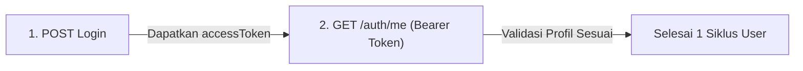

# ⚡ 19 - Performance Testing Dasar dengan k6

## 1. Mindset: Manual QA vs Automation vs Performance Testing

| Aspek | Manual QA | UI Automation (Playwright) | Performance Testing (k6) |
| :--- | :--- | :--- | :--- |
| **Fokus Utama** | *"Apakah fiturnya jalan?"* | *"Apakah alur UI lulus uji regresi?"* | *"Apakah sistem kuat & seberapa cepat pas diserbu banyak user?"* |
| **Target Uji** | Tombol, form, tampilan | Browser, DOM, Locator/Selector | HTTP API Endpoint / Backend & Database |
| **Beban Pengujian** | 1 orang nyata | 1 browser (biasanya 1–4 thread) | Ratusan hingga ribuan Virtual Users (VUs) paralel |

> [!NOTE]
> **Kenapa k6 untuk QA?**
> - **Bebas Locator Hell:** Tidak perlu berurusan dengan XPath, CSS selector, atau flakiness UI DOM. Langsung menembak endpoint HTTP (REST API).
> - **Script JavaScript Standar:** Scripting mudah dipelajari tanpa setup arsitektur rumit.
> - **Ringan & Cepat:** Berbasis binary mandiri (Go runtime), tanpa beban berat `node_modules` atau dependencies browser.

---

## 2. Anatomi Dasar Script k6

Script pengujian k6 minimal terdiri dari 3 bagian:

```javascript
import http from 'k6/http';
import { check, sleep } from 'k6';

// 1. OPSI PENGUJIAN (Load Configuration)
export const options = {
  vus: 20,         // Jumlah Virtual Users (robot virtual)
  duration: '5s',  // Durasi pengujian
};

// 2. SKENARIO (User Journey)
export default function () {
  // Aksi HTTP Request
  const res = http.get('https://test.k6.io');

  // Validasi (Assertion / Check)
  check(res, {
    'apakah status 200': (r) => r.status === 200,
  });

  // Think Time (Jeda istirahat realistis)
  sleep(1);
}
```

### Cara Kerja Iterasi:
- Setiap **VU (Virtual User)** berjalan mandiri secara **paralel**.
- Selama durasi pengujian aktif, VU akan mengulang eksekusi fungsi `default` terus-menerus.
- Total `iterations` = akumulasi seluruh putaran yang berhasil diselesaikan oleh seluruh VU.

---

## 3. Metrik Utama di Terminal k6 (Golden Metrics)

Saat menjalankan `k6 run <nama_file>.js`, fokuskan pembacaan pada **4 metrik kunci**:

```text
✓ apakah status 200     (100.00% 79 out of 79)

HTTP
http_req_duration.......: avg=135.76ms ... p(90)=251.55ms p(95)=252.29ms
  { expected_response:true }...: avg=135.76ms ... p(95)=252.29ms
http_req_failed.........: 0.00%  0 out of 158
http_reqs...............: 158    25.2/s

EXECUTION
iterations..............: 79     12.6/s
```

| Metrik | Makna QA |
| :--- | :--- |
| **`check` (Centang Hijau)** | Validasi respons per request. Menjamin request bukan hanya cepat tapi juga mengembalikan status code / body data yang valid. |
| **`http_req_failed`** | Persentase request yang gagal/timeout/error 5xx. Standar kelulusan biasanya 0% atau `< 1%`. |
| **`http_req_duration`** | Kecepatan respons server (Response Time). Lihat nilai `avg` dan terutama `p(95)`. |
| **`iterations`** | Jumlah transaksi/siklus lengkap yang berhasil diproses sistem dalam rentang waktu uji. |

---

## 4. Kenapa Percentile 95 (`p(95)`) Lebih Penting dari Rata-rata (`avg`)?

Nilai rata-rata (`avg`) sering **menipu** jika terdapat variasi ekstrem (*outlier*).

> **Contoh Kasus:**  
> Dari 100 request:
> - 99 request dijawab dalam 100 ms.
> - 1 request macet dan butuh 30.000 ms (30 detik).
> - Rata-rata (`avg`) = ~399 ms *(terlihat bagus & lulus)*.
> - Namun ada 1 user yang mengalami hang total selama 30 detik!

* **`p(95)`** mengurutkan seluruh respons dari tercepat hingga terlambat, lalu mengambil titik di peringkat 95%.
* Jika `p(95) = 252ms`, artinya **95% pengguna merasakan kecepatan di bawah 252 ms**, merefleksikan performa nyata sebagian besar pengguna.

---

## 5. Standar Waktu Respons (SLA Benchmark)

| Waktu Respons | Kategori | Dampak Pengguna |
| :--- | :--- | :--- |
| **$< 500 \text{ ms}$** | 🚀 Sangat Kilat | Terasa instan, performa ideal. |
| **$500 \text{ ms} - 2.000 \text{ ms}$** | 🟢 Wajar / Normal | Batas kenyamanan navigasi web/aplikasi. |
| **$2.000 \text{ ms} - 5.000 \text{ ms}$** | 🟡 Mulai Lemot | Pengguna mulai merasa ada jeda/loading. |
| **$> 5.000 \text{ ms}$** | 🔴 Kritis / Lemot Parah | Risiko tinggi pengguna meninggalkan sistem (*drop off*). |

---

## 6. Struktur Pembagian Log Terminal

1. **`HTTP`:** Mengukur kesehatan sisi server (durasi respons, tingkat kegagalan request, throughput `http_reqs/s`).
   - Baris kembar `{ expected_response:true }` mengukur durasi khusus request yang berstatus sukses (jika ada request gagal, angka ini akan berbeda dengan baris total).
2. **`EXECUTION`:** Mengukur kinerja script runner k6 di mesin lokal (jumlah robot aktif `vus`, total siklus `iterations`, durasi per putaran `iteration_duration`).
3. **`NETWORK`:** Mengukur volume lalu lintas jaringan (`data_sent` dan `data_received` dalam kB).

---

## 7. Perintah Dasar k6

```powershell
# Jalankan script pengujian
k6 run script.js

# Jalankan dengan override user & durasi langsung dari terminal
k6 run --vus 50 --duration 30s script.js
```

---

## 8. Pengujian API POST dengan JSON Payload & Headers

Di dunia industri, `POST` adalah method paling kritikal karena memicu penulisan database, enkripsi keamanan, dan komputasi CPU backend yang berat.

```javascript
import http from "k6/http";
import { check, sleep } from "k6";

export const options = {
  vus: 20,
  duration: "5s",
  thresholds: {
    http_req_duration: ["p(95)<1500"], // 95% request wajib < 1.5 detik
    http_req_failed: ["rate==0"],      // Error harus 0%
  },
};

export default function () {
  const url = "https://dummyjson.com/auth/login";

  // 1. Data JSON (Wajib di-JSON.stringify agar terkirim sebagai teks murni di kabel HTTP)
  const payload = JSON.stringify({
    username: "emilys",
    password: "emilyspass",
  });

  // 2. Header spesifikasi tipe konten
  const params = {
    headers: {
      "Content-Type": "application/json",
    },
  };

  // 3. Eksekusi Request POST
  const res = http.post(url, payload, params);

  // 4. Validasi Status dan Isi Token JSON
  check(res, {
    "login status 200": (r) => r.status === 200,
    "dapat access token": (r) => r.json("accessToken") !== undefined,
  });

  sleep(1);
}
```

> [!NOTE]
> **Kenapa `JSON.stringify` Wajib?**
> Protokol HTTP hanya mentransfer teks/string mentah. Objek JavaScript `{}` jika dikirim langsung tanpa stringify akan berubah menjadi teks rusak `"[object Object]"` dan ditolak server dengan Error 400 Bad Request.

---

## 9. API Chaining (Oper-operan Data Antar-API)

API Chaining adalah teknik menyambungkan respons dari **API Pertama** untuk dijadikan parameter input pada **API Kedua** dalam satu alur utuh (*User Journey*).



### Implementasi Script Chaining:
```javascript
export default function () {
  // --- LANGKAH 1: Login dan Ambil Token ---
  const loginRes = http.post("https://dummyjson.com/auth/login", payload, params);
  
  // Tangkap nilai token dari response body JSON
  const token = loginRes.json("accessToken");

  check(loginRes, {
    "1. login berhasil 200": (r) => r.status === 200,
    "2. token didapat": () => token !== undefined && token !== "",
  });

  // --- LANGKAH 2: Pakai Token untuk Akses Endpoint Terproteksi ---
  const authParams = {
    headers: {
      "Authorization": `Bearer ${token}`, // Handoff token ke Header Authorization
    },
  };

  const profileRes = http.get("https://dummyjson.com/auth/me", authParams);

  check(profileRes, {
    "3. akses profil 200": (r) => r.status === 200,
    "4. data user valid": (r) => r.json("username") === "emilys",
  });

  sleep(1);
}
```

* **Rasio Throughput Chaining:** Dalam 1 putaran (`iteration`) terdapat 2 panggilan HTTP. Jika selesai 15 iterasi, maka total request yang terjadi di backend adalah $15 \times 2 = \mathbf{30 \text{ HTTP requests}}$.

---

## 10. Pemodelan Trafik Bertahap (`stages` / Ramp-up)

Pengujian beban di industri 90% menggunakan `stages` untuk meniru perilaku alami manusia (tidak langsung menabrakkan ratusan user secara instan di detik ke-0).

```javascript
export const options = {
  stages: [
    { duration: "5s", target: 5 },   // 1. Pagi Hari: Trafik awal masuk pelan-pelan (5 user)
    { duration: "5s", target: 15 },  // 2. Jam Kerja: Naik bertahap (15 user)
    { duration: "10s", target: 30 }, // 3. Jam Puncak (Rush Hour): Beban tertinggi (30 user)
    { duration: "5s", target: 0 },   // 4. Pendinginan: User menyelesaikan sesi dan pulang (0 user)
  ],
  thresholds: {
    http_req_duration: ["p(95)<1500"],
    http_req_failed: ["rate==0"],
  },
};
```

---

## 11. Strategi Pemilihan Fitur Uji (Scope Priority)

Seorang QA tidak perlu menguji semua fitur aplikasi untuk performance test. Terapkan prinsip **Jalur Duit & Jalur Macet**:

| Prioritas Uji | Kategori Fitur | Contoh Kasus | Tindakan QA |
| :--- | :--- | :--- | :--- |
| 🔴 **WAJIB (P1)** | **Jalur Duit (Revenue Flows)** | Checkout keranjang, Pembayaran, Top-up saldo, Booking tiket | Uji skenario End-to-End dengan beban puncak & spike |
| 🔴 **WAJIB (P1)** | **Jalur Macet (High Concurrency)** | Login jam masuk kantor (HRIS), Flash Sale katalog, Pencarian barang berkriteria rumit | Uji Stress Test hingga breaking point |
| ⚪ **ABAIKAN (P3)** | **Fitur Santai (Low Traffic)** | Halaman *About Us*, Ubah Password, Pengajuan Cuti Tahunan, Syarat & Ketentuan | Cukup Functional Test, tidak perlu di-load test |

---

## 12. Troubleshooting & Masalah Umum yang Ditemukan

1. **Database Indexing:**  
   Query search lambat saat user ramai biasanya disebabkan kolom pencarian belum di-*index* oleh Backend Engineer (server terpaksa melakukan *full table scan*).
2. **Connection Pool Exhaustion (Error 504 Gateway Timeout):**  
   Batas kuota antrean koneksi database/server kepenuhan, sehingga request user baru terpaksa menunggu sampai timeout dan dibatalkan.
3. **Memory Leak (RAM Tidak Turun):**  
   Penggunaan RAM server terus meningkat tajam dan tidak kembali turun meskipun pengujian k6 sudah selesai. Mengindikasikan ada objek data yang tertahan di memori backend.
4. **Virtual Waiting Room (Ruang Tunggu Antrean):**  
   Solusi arsitektur untuk menahan lonjakan trafik berlebih (misal war tiket konser) di luar gerbang agar server inti transaksi tidak tumbang.

