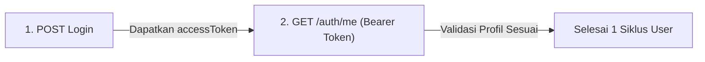

# ⚡ 19 - Performance Testing Dasar dengan k6

## 1. Mindset: Manual QA vs Automation vs Performance Testing

| Aspek | Manual QA | UI Automation (Playwright) | Performance Testing (k6) |
| :--- | :--- | :--- | :--- |
| **Fokus Utama** | *"Apakah fiturnya jalan?"* | *"Apakah alur UI lulus uji regresi?"* | *"Apakah sistem kuat & seberapa cepat pas diserbu banyak user?"* |
| **Target Uji** | Tombol, form, tampilan | Browser, DOM, Locator/Selector | HTTP API Endpoint / Backend & Database |
| **Beban Pengujian** | 1 orang nyata | 1 browser (biasanya 1–4 thread) | Ratusan hingga ribuan Virtual Users (VUs) paralel |

> [!NOTE]
> **Kenapa k6 untuk QA?**
> - **Bebas Locator Hell:** Tidak perlu berurusan dengan XPath, CSS selector, atau flakiness UI DOM. Langsung menembak endpoint HTTP (REST API).
> - **Script JavaScript Standar:** Scripting mudah dipelajari tanpa setup arsitektur rumit.
> - **Ringan & Cepat:** Berbasis binary mandiri (Go runtime), tanpa beban berat `node_modules` atau dependencies browser.

---

## 2. Anatomi Dasar Script k6

Script pengujian k6 minimal terdiri dari 3 bagian:

```javascript
import http from 'k6/http';
import { check, sleep } from 'k6';

// 1. OPSI PENGUJIAN (Load Configuration)
export const options = {
  vus: 20,         // Jumlah Virtual Users (robot virtual)
  duration: '5s',  // Durasi pengujian
};

// 2. SKENARIO (User Journey)
export default function () {
  // Aksi HTTP Request
  const res = http.get('https://test.k6.io');

  // Validasi (Assertion / Check)
  check(res, {
    'apakah status 200': (r) => r.status === 200,
  });

  // Think Time (Jeda istirahat realistis)
  sleep(1);
}
```

### Cara Kerja Iterasi:
- Setiap **VU (Virtual User)** berjalan mandiri secara **paralel**.
- Selama durasi pengujian aktif, VU akan mengulang eksekusi fungsi `default` terus-menerus.
- Total `iterations` = akumulasi seluruh putaran yang berhasil diselesaikan oleh seluruh VU.

---

## 3. Metrik Utama di Terminal k6 (Golden Metrics)

Saat menjalankan `k6 run <nama_file>.js`, fokuskan pembacaan pada **4 metrik kunci**:

```text
✓ apakah status 200     (100.00% 79 out of 79)

HTTP
http_req_duration.......: avg=135.76ms ... p(90)=251.55ms p(95)=252.29ms
  { expected_response:true }...: avg=135.76ms ... p(95)=252.29ms
http_req_failed.........: 0.00%  0 out of 158
http_reqs...............: 158    25.2/s

EXECUTION
iterations..............: 79     12.6/s
```

| Metrik | Makna QA |
| :--- | :--- |
| **`check` (Centang Hijau)** | Validasi respons per request. Menjamin request bukan hanya cepat tapi juga mengembalikan status code / body data yang valid. |
| **`http_req_failed`** | Persentase request yang gagal/timeout/error 5xx. Standar kelulusan biasanya 0% atau `< 1%`. |
| **`http_req_duration`** | Kecepatan respons server (Response Time). Lihat nilai `avg` dan terutama `p(95)`. |
| **`iterations`** | Jumlah transaksi/siklus lengkap yang berhasil diproses sistem dalam rentang waktu uji. |

---

## 4. Kenapa Percentile 95 (`p(95)`) Lebih Penting dari Rata-rata (`avg`)?

Nilai rata-rata (`avg`) sering **menipu** jika terdapat variasi ekstrem (*outlier*).

> **Contoh Kasus:**  
> Dari 100 request:
> - 99 request dijawab dalam 100 ms.
> - 1 request macet dan butuh 30.000 ms (30 detik).
> - Rata-rata (`avg`) = ~399 ms *(terlihat bagus & lulus)*.
> - Namun ada 1 user yang mengalami hang total selama 30 detik!

* **`p(95)`** mengurutkan seluruh respons dari tercepat hingga terlambat, lalu mengambil titik di peringkat 95%.
* Jika `p(95) = 252ms`, artinya **95% pengguna merasakan kecepatan di bawah 252 ms**, merefleksikan performa nyata sebagian besar pengguna.

---

## 5. Standar Waktu Respons (SLA Benchmark)

| Waktu Respons | Kategori | Dampak Pengguna |
| :--- | :--- | :--- |
| **$< 500 \text{ ms}$** | 🚀 Sangat Kilat | Terasa instan, performa ideal. |
| **$500 \text{ ms} - 2.000 \text{ ms}$** | 🟢 Wajar / Normal | Batas kenyamanan navigasi web/aplikasi. |
| **$2.000 \text{ ms} - 5.000 \text{ ms}$** | 🟡 Mulai Lemot | Pengguna mulai merasa ada jeda/loading. |
| **$> 5.000 \text{ ms}$** | 🔴 Kritis / Lemot Parah | Risiko tinggi pengguna meninggalkan sistem (*drop off*). |

---

## 6. Struktur Pembagian Log Terminal

1. **`HTTP`:** Mengukur kesehatan sisi server (durasi respons, tingkat kegagalan request, throughput `http_reqs/s`).
   - Baris kembar `{ expected_response:true }` mengukur durasi khusus request yang berstatus sukses (jika ada request gagal, angka ini akan berbeda dengan baris total).
2. **`EXECUTION`:** Mengukur kinerja script runner k6 di mesin lokal (jumlah robot aktif `vus`, total siklus `iterations`, durasi per putaran `iteration_duration`).
3. **`NETWORK`:** Mengukur volume lalu lintas jaringan (`data_sent` dan `data_received` dalam kB).

---

## 7. Perintah Dasar k6

```powershell
# Jalankan script pengujian
k6 run script.js

# Jalankan dengan override user & durasi langsung dari terminal
k6 run --vus 50 --duration 30s script.js
```

---

## 8. Pengujian API POST dengan JSON Payload & Headers

Di dunia industri, `POST` adalah method paling kritikal karena memicu penulisan database, enkripsi keamanan, dan komputasi CPU backend yang berat.

```javascript
import http from "k6/http";
import { check, sleep } from "k6";

export const options = {
  vus: 20,
  duration: "5s",
  thresholds: {
    http_req_duration: ["p(95)<1500"], // 95% request wajib < 1.5 detik
    http_req_failed: ["rate==0"],      // Error harus 0%
  },
};

export default function () {
  const url = "https://dummyjson.com/auth/login";

  // 1. Data JSON (Wajib di-JSON.stringify agar terkirim sebagai teks murni di kabel HTTP)
  const payload = JSON.stringify({
    username: "emilys",
    password: "emilyspass",
  });

  // 2. Header spesifikasi tipe konten
  const params = {
    headers: {
      "Content-Type": "application/json",
    },
  };

  // 3. Eksekusi Request POST
  const res = http.post(url, payload, params);

  // 4. Validasi Status dan Isi Token JSON
  check(res, {
    "login status 200": (r) => r.status === 200,
    "dapat access token": (r) => r.json("accessToken") !== undefined,
  });

  sleep(1);
}
```

> [!NOTE]
> **Kenapa `JSON.stringify` Wajib?**
> Protokol HTTP hanya mentransfer teks/string mentah. Objek JavaScript `{}` jika dikirim langsung tanpa stringify akan berubah menjadi teks rusak `"[object Object]"` dan ditolak server dengan Error 400 Bad Request.

---

## 9. API Chaining (Oper-operan Data Antar-API)

API Chaining adalah teknik menyambungkan respons dari **API Pertama** untuk dijadikan parameter input pada **API Kedua** dalam satu alur utuh (*User Journey*).



### Implementasi Script Chaining:
```javascript
export default function () {
  // --- LANGKAH 1: Login dan Ambil Token ---
  const loginRes = http.post("https://dummyjson.com/auth/login", payload, params);
  
  // Tangkap nilai token dari response body JSON
  const token = loginRes.json("accessToken");

  check(loginRes, {
    "1. login berhasil 200": (r) => r.status === 200,
    "2. token didapat": () => token !== undefined && token !== "",
  });

  // --- LANGKAH 2: Pakai Token untuk Akses Endpoint Terproteksi ---
  const authParams = {
    headers: {
      "Authorization": `Bearer ${token}`, // Handoff token ke Header Authorization
    },
  };

  const profileRes = http.get("https://dummyjson.com/auth/me", authParams);

  check(profileRes, {
    "3. akses profil 200": (r) => r.status === 200,
    "4. data user valid": (r) => r.json("username") === "emilys",
  });

  sleep(1);
}
```

* **Rasio Throughput Chaining:** Dalam 1 putaran (`iteration`) terdapat 2 panggilan HTTP. Jika selesai 15 iterasi, maka total request yang terjadi di backend adalah $15 \times 2 = \mathbf{30 \text{ HTTP requests}}$.

---

## 10. Pemodelan Trafik Bertahap (`stages` / Ramp-up)

Pengujian beban di industri 90% menggunakan `stages` untuk meniru perilaku alami manusia (tidak langsung menabrakkan ratusan user secara instan di detik ke-0).

```javascript
export const options = {
  stages: [
    { duration: "5s", target: 5 },   // 1. Pagi Hari: Trafik awal masuk pelan-pelan (5 user)
    { duration: "5s", target: 15 },  // 2. Jam Kerja: Naik bertahap (15 user)
    { duration: "10s", target: 30 }, // 3. Jam Puncak (Rush Hour): Beban tertinggi (30 user)
    { duration: "5s", target: 0 },   // 4. Pendinginan: User menyelesaikan sesi dan pulang (0 user)
  ],
  thresholds: {
    http_req_duration: ["p(95)<1500"],
    http_req_failed: ["rate==0"],
  },
};
```

---

## 11. Strategi Pemilihan Fitur Uji (Scope Priority)

Seorang QA tidak perlu menguji semua fitur aplikasi untuk performance test. Terapkan prinsip **Jalur Duit & Jalur Macet**:

| Prioritas Uji | Kategori Fitur | Contoh Kasus | Tindakan QA |
| :--- | :--- | :--- | :--- |
| 🔴 **WAJIB (P1)** | **Jalur Duit (Revenue Flows)** | Checkout keranjang, Pembayaran, Top-up saldo, Booking tiket | Uji skenario End-to-End dengan beban puncak & spike |
| 🔴 **WAJIB (P1)** | **Jalur Macet (High Concurrency)** | Login jam masuk kantor (HRIS), Flash Sale katalog, Pencarian barang berkriteria rumit | Uji Stress Test hingga breaking point |
| ⚪ **ABAIKAN (P3)** | **Fitur Santai (Low Traffic)** | Halaman *About Us*, Ubah Password, Pengajuan Cuti Tahunan, Syarat & Ketentuan | Cukup Functional Test, tidak perlu di-load test |

---

## 12. Troubleshooting & Masalah Umum yang Ditemukan

1. **Database Indexing:**  
   Query search lambat saat user ramai biasanya disebabkan kolom pencarian belum di-*index* oleh Backend Engineer (server terpaksa melakukan *full table scan*).
2. **Connection Pool Exhaustion (Error 504 Gateway Timeout):**  
   Batas kuota antrean koneksi database/server kepenuhan, sehingga request user baru terpaksa menunggu sampai timeout dan dibatalkan.
3. **Memory Leak (RAM Tidak Turun):**  
   Penggunaan RAM server terus meningkat tajam dan tidak kembali turun meskipun pengujian k6 sudah selesai. Mengindikasikan ada objek data yang tertahan di memori backend.
4. **Virtual Waiting Room (Ruang Tunggu Antrean):**  
   Solusi arsitektur untuk menahan lonjakan trafik berlebih (misal war tiket konser) di luar gerbang agar server inti transaksi tidak tumbang.

---

## 13. Data-Driven Testing (DDT) Multi-User

DDT di k6 memisahkan kode script dari kumpulan data pengujian (`users.json`). Digunakan agar simulasi multi-user realistis dan tidak terjadi tabrakan sesi (*session overwrite*).

### A. Penggunaan `SharedArray` (Super Irit RAM)
Diimpor dari `k6/data`. File JSON hanya dimuat **1 kali saja** ke memori laptop dan dibagi bersama ke seluruh robot (*shared memory*).

```javascript
import { SharedArray } from "k6/data";

const users = new SharedArray("daftar user", function () {
  return JSON.parse(open("./data/users.json"));
});
```

### B. Variabel Bawaan k6 (`__VU` & `__ITER`)
* **`__VU` (Virtual User):** Nomor ID unik tiap robot (mulai dari `1, 2, 3...`).
* **`__ITER` (Iteration):** Nomor putaran siklus yang sedang dijalankan robot (mulai dari `0, 1, 2...`).

### C. Logika Rotasi Akun (Modulo Pattern)
```javascript
const user = users[(__VU - 1) % users.length];
```
* **Kenapa `__VU - 1`?** Karena nomor robot mulai dari `1`, sedangkan indeks array JavaScript mulai dari `0`.
* **Kenapa `% users.length`?** Menggunakan rumus sisa pembagian (sistem jam dinding). Jika jumlah robot melebihi jumlah akun yang tersedia, robot otomatis memutar kembali mengambil akun dari indeks awal tanpa memicu error `undefined`.

---

## 14. Standardisasi Struktur Folder Proyek k6 (API Service Pattern)

Di Playwright, struktur kode dirapikan menggunakan **Page Object Model (POM)**. Di k6, standarisasi industri menggunakan **API Service Pattern**.

### Perbandingan Arsitektur: Playwright vs k6

| Lapisan (Layer) | UI Automation (Playwright Python) | Performance Testing (k6 JavaScript) | Fungsi |
| :--- | :--- | :--- | :--- |
| **Data Layer** | `data/test_data.json` | `data/users.json` | File data akun/payload statis |
| **Object Layer** | `pages/login_page.py` *(POM)* | `services/auth.service.js` *(API Object)* | Fungsi reusable pemanggil endpoint API |
| **Test Layer** | `tests/test_login.py` | `tests/login-test.js` | Skenario bisnis utama (`export default`) |

### Struktur Folder Rekomendasi Industri:
```text
project-k6/
├── data/
│   └── users.json           # Kumpulan kredensial pengujian
├── services/                # Komponen pemanggil API (Pengganti POM)
│   ├── auth.service.js      # Fungsi login(), logout()
│   └── user.service.js      # Fungsi getProfile()
└── tests/                   # Skenario Pengujian (User Journey)
    └── user-journey-test.js # File eksekusi utama k6
```

### Contoh Implementasi:

**1. `services/auth.service.js` (Service Layer):**
```javascript
import http from "k6/http";

export function login(username, password) {
  const url = "https://dummyjson.com/auth/login";
  const payload = JSON.stringify({ username, password });
  const params = { headers: { "Content-Type": "application/json" } };
  return http.post(url, payload, params);
}

export function getProfile(token) {
  const url = "https://dummyjson.com/auth/me";
  const params = { headers: { Authorization: `Bearer ${token}` } };
  return http.get(url, params);
}
```

**2. `tests/user-journey-test.js` (Test Layer - Sangat Bersih & Ringkas):**
```javascript
import { check, sleep } from "k6";
import { SharedArray } from "k6/data";
import { login, getProfile } from "../services/auth.service.js";

const users = new SharedArray("users", () => JSON.parse(open("../data/users.json")));

export const options = {
  vus: 5,
  duration: "5s",
};

export default function () {
  const user = users[(__VU - 1) % users.length];

  // Eksekusi aksi cukup panggil fungsi service
  const loginRes = login(user.username, user.password);
  const token = loginRes.json("accessToken");

  const profileRes = getProfile(token);

  check(profileRes, {
    "akses profil 200": (r) => r.status === 200,
    "user cocok": (r) => r.json("username") === user.username,
  });

  sleep(1);
}
```

---

## 15. Katalog 8 Pola Alur Pengujian (Flow Patterns) di Industri

Di dunia nyata, hampir semua aplikasi web/mobile diuji menggunakan **8 Pola Alur Standar** ini:

| No | Pola Alur (Flow Pattern) | Karakteristik Beban | Pola Urutan Kodingan | File Skenario |
| :--- | :--- | :--- | :--- | :--- |
| **1** | **Browsing & Discovery** *(Paling Sering)* | **Trafik Sangat Tinggi (GET Heavy)** | `Login` $\rightarrow$ `Search Keyword` $\rightarrow$ `Filter Harga/Kategori` $\rightarrow$ `Detail Produk` | `browse-flow.test.js` |
| **2** | **Transaction / Conversion** *(Jalur Duit)* | **Kritis & Rawan Race Condition (POST/PUT)** | `Pilih Barang` $\rightarrow$ `Masuk Keranjang` $\rightarrow$ `Pilih Kurir` $\rightarrow$ `Bayar (Lock Stok)` | `checkout-flow.test.js` |
| **3** | **Burst / Spike Event** *(Jam Masuk)* | **Lonjakan Instan Ribuan Orang** | `Absen Masuk HRIS Pagi` ATAU `Klaim Kupon Diskon 99%` | `burst-spike.test.js` |
| **4** | **Admin CRUD Lifecycle** *(Operasional)* | **Trafik Rendah, Database Heavy** | `Login Admin` $\rightarrow$ `Create Data Tumbal` $\rightarrow$ `Update Status` $\rightarrow$ `Delete (Teardown)` | `admin-crud.test.js` |
| **5** | **Heavy Export & Reporting** | **Beban CPU Database Berat (Jarang)** | `Pilih Rentang Tanggal 1 Tahun` $\rightarrow$ `Request Export Excel/PDF` | `report-export.test.js` |
| **6** | **Auth & Token Refresh Lifecycle** | **Validasi Stabilitas Keamanan Sesi** | `Login` $\rightarrow$ `Tunggu Token Expired` $\rightarrow$ `POST /refresh-token` $\rightarrow$ `Logout` | `auth-lifecycle.test.js` |
| **7** | **Bulk Action / Batch Import** | **Uji Proses Antrean Latar Belakang** | `Upload CSV 1.000 Baris` $\rightarrow$ `Bulk Approve 100 Data` $\rightarrow$ `Bulk Delete` | `bulk-action.test.js` |
| **8** | **Webhook & Third-Party Callback** | **Simulasi Respon Mitra Pembayaran** | `Trigger Transaksi` $\rightarrow$ `Simulasi Webhook Notifikasi Bayar (Midtrans/Xendit)` | `webhook-callback.test.js` |

> [!TIP]
> **Aturan Pembagian File:**
> Masing-masing pola di atas dibuatkan **1 file test mandiri** di folder `tests/`, karena alur cerita dan perilaku penggunanya berbeda-beda.

---

## 16. Cara Mengatur SLA (Thresholds) Berbeda untuk Tiap Endpoint API

Di industri nyata:
* **Service (`services/`):** **TIDAK memiliki options!** Service murni kumpulan fungsi pemanggil API saja.
* **Options (`options`):** Milik file skenario di `tests/`.

Namun, dalam 1 skenario, **tiap endpoint API sering kali memiliki standar KKM/SLA kecepatan yang berbeda-beda**:
* API Pencarian (GET): Wajib sangat cepat $\rightarrow$ `p(95) < 300ms`.
* API Checkout (POST): Boleh lebih lambat karena memproses transaksi $\rightarrow$ `p(95) < 2000ms`.

### Solusi k6: Tagging Endpoint (`tags: { name: ... }`)

Di fungsi service atau request, berikan label tag `name`:
```javascript
// 1. Tagging API Pencarian
http.get("https://api.com/products?search=phone", {
  tags: { name: "SearchAPI" },
});

// 2. Tagging API Checkout
http.post("https://api.com/checkout", payload, {
  headers: { ... },
  tags: { name: "CheckoutAPI" },
});
```

Lalu di file `config/options.js`, tentukan KKM spesifik per endpoint:
```javascript
export const options = {
  stages: [ ... ],
  thresholds: {
    // KKM Khusus API Pencarian: Harus kilat di bawah 300ms
    'http_req_duration{name:SearchAPI}': ['p(95)<300'],

    // KKM Khusus API Checkout: Toleransi sampai 2 detik
    'http_req_duration{name:CheckoutAPI}': ['p(95)<2000'],

    // KKM Total Seluruh Sistem: Error harus 0%
    'http_req_failed': ['rate==0'],
  },
};
```
Dengan teknik **Tagged Thresholds** ini, laporan k6 di terminal akan memisahkan rapor kelulusan per masing-masing API secara presisi tanpa campur aduk!

---

## 17. Pola Konfigurasi "1 Service 1 Option" (Microservices Options Hub)

Saat menguji arsitektur Microservices atau modul terisolasi, setiap Service memiliki karakteristik beban dan batasan yang berbeda secara mandiri:
* **Auth Service:** Beban sedang (100 VUs), waktu respons wajib < 1 detik.
* **Product Catalog Service:** Beban sangat tinggi (500 VUs), waktu respons wajib kilat < 300 ms.
* **Checkout Service:** Beban kecil-menengah (50 VUs), waktu respons transaksi boleh < 2 detik.

Agar pengaturan beban per service ini tetap terpusat dan tidak duplikasi (**100% DRY**), standarnya disimpan di dalam satu file repositori konfigurasi.

### A. Repositori Pusat: `config/service-options.js`

```javascript
// config/service-options.js

export const serviceOptions = {
  // 1. Opsi Khusus Service Auth (Login)
  auth: {
    vus: 100,
    duration: "30s",
    thresholds: {
      http_req_duration: ["p(95)<1000"], // Login wajib < 1 detik
      http_req_failed: ["rate==0"],
    },
  },

  // 2. Opsi Khusus Service Produk (Katalog/Pencarian)
  product: {
    vus: 500, // Diserbu lebih banyak user
    duration: "1m",
    thresholds: {
      http_req_duration: ["p(95)<300"], // Pencarian wajib kilat < 300ms
      http_req_failed: ["rate==0"],
    },
  },

  // 3. Opsi Khusus Service Transaksi / Checkout
  checkout: {
    vus: 50, // User lebih sedikit tapi proses database berat
    duration: "30s",
    thresholds: {
      http_req_duration: ["p(95)<2000"], // Toleransi transaksi sampai 2 detik
      http_req_failed: ["rate==0"],
    },
  },
};
```

### B. Cara Penggunaan di Masing-masing File Test (1 Baris Saja)

Di setiap file skenario pengetesan spesifik service, cukup mengimpor opsi miliknya:

* **File `tests/auth.test.js`:**
  ```javascript
  import { serviceOptions } from "../config/service-options.js";

  // Langsung gunakan opsi khusus Auth
  export const options = serviceOptions.auth;

  export default function () {
    // Jalankan pengetesan API Auth
  }
  ```

* **File `tests/product.test.js`:**
  ```javascript
  import { serviceOptions } from "../config/service-options.js";

  // Langsung gunakan opsi khusus Product
  export const options = serviceOptions.product;

  export default function () {
    // Jalankan pengetesan API Product
  }
  ```

### Keunggulan Arsitektur Ini:
1. **Separation of Concerns:** Beban dan batasan tiap service terdefinisi jelas sesuai kapasitas modul masing-masing.
2. **Single Source of Truth:** Jika ada perubahan target user (misal produk dinaikkan ke 1.000 VUs), cukup edit 1 baris di `config/service-options.js`.
3. **File Test Bersih:** File test tidak terbebani oleh puluhan baris konfigurasi JSON options.


