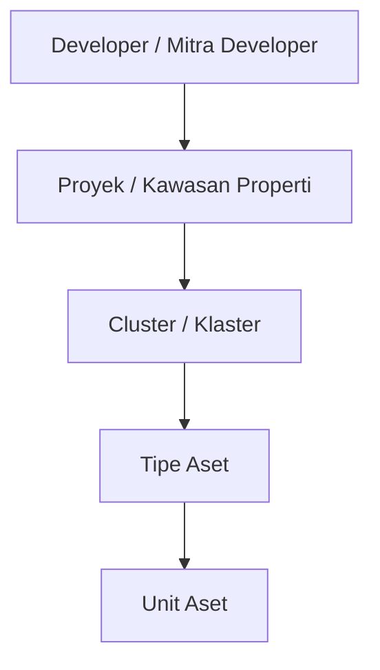
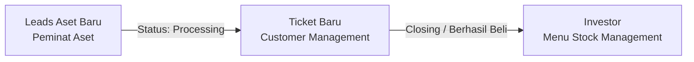

# 📝 Catatan Workshop - Penjelasan Alur Bisnis BSN (BA)

* **Tanggal**: 2026-11-02
* **Narasumber**: Business Analyst (BA)
* **Dokumenter**: Dani (QA)
* **Status**: In Progress (Updating berkala sesuai sesi workshop)

---

## 🏗️ 1. Hirarki Entitas Developer & Aset

Sebelum Aset Baru dapat dibuat, entitas Developer wajib terdaftar terlebih dahulu di sistem.

* **Urutan Hirarki**:
  1. **Developer**: Entitas badan usaha / mitra pengembang (memiliki Nomor Induk Berusaha, NPWP, CIF Developer, PIC, KC Pengampu, Legalitas & PKS).
  2. **Proyek**: Proyek kawasan properti yang dikembangkan oleh developer.
  3. **Cluster**: Klaster spesifik di dalam suatu proyek.
  4. **Tipe**: Tipe unit properti di dalam klaster.
  5. **Unit**: Unit fisik properti individual yang siap dipasarkan.

---

## 👥 2. Pembuatan & Approval Developer (Internal vs External)

Terdapat 2 jalur pendaftaran Mitra Developer:

| Jalur Pendaftaran | Kebutuhan Approval | Keterangan Flow |
| :--- | :---: | :--- |
| **Internal** (Backoffice / Admin) | ❌ **Tanpa Approval** | Langsung tercatat dan aktif di sistem tanpa proses persetujuan berjenjang. |
| **External** (Portal Developer) | ⚠️ **Wajib Approval** | Membutuhkan proses verifikasi dan persetujuan (approval) oleh pihak internal bank terlebih dahulu sebelum aktif. |

---

## 🏡 3. Alur, Input & Aturan Aset Baru

### A. Role Kewenangan Aset Baru
* **Approval & Publishing**: Dilakukan oleh **Admin Pusat**.
* Admin Pusat berwenang menyetujui (*approve*) pendaftaran aset baru dan merilis (*published*) aset ke katalog agar live/dapat diakses publik.

### B. Urutan Tipe Aset Baru (Prioritas)
1. **Rumah**
2. **Appart** (Apartemen)
3. **Ruko**
4. *Tipe aset lainnya bebas (opsional/fleksibel)*

### C. Alur Form Input Aset (Wizard Steps)
* **Step 2 (Informasi Harga Aset)**:
  * Terdapat konfigurasi nominal **Minimal DP** (Down Payment).
  * Angka yang disetel di Step 2 ini akan menjadi batasan minimal uang muka yang wajib dipenuhi oleh calon pembeli/nasabah.

---

## 🎯 4. Siklus Pengelolaan Nasabah (Leads ➔ Ticket ➔ Investor)

Alur pergerakan data calon pembeli dari minat awal hingga akad/pembelian selesai:

### A. Leads Aset Baru (`Customer Management` → `Leads Aset Baru`)
* **Definisi**: Data nasabah/calon pembeli yang menyatakan minat untuk membeli aset baru.
* **Pipeline Status Leads**:
  * `Semua`
  * `Tindak Lanjut`
  * `Processing` *(Trigger Point)*
  * `Terverifikasi`
  * `Selesai`
  * `Batal`
* **Auto-generate Ticket**: Saat status leads diproses / mencapai tahap **Processing**, sistem secara otomatis membuat **Ticket Baru** di menu `Ticket Aset Baru` untuk penanganan tindak lanjut sales/CS.
* **Kondisi Teknis Saat Ini**: Halaman `Leads Aset Baru` saat ini masih menampilkan data fallback dari `Leads Aset Lelang` karena endpoint API khusus aset baru masih dalam proses integrasi backend.

### B. Menu Investor (`Stock Management` → `Investor`)
* **Definisi**: Kumpulan data nasabah yang **sudah berhasil membeli rumah / aset properti** (closing transaksi tuntas).
* Berperan sebagai database pembeli resmi / pemilik aset properti terdaftar.

---

## 🖥️ 5. Peta Modul & Navigasi Terkait

* **Customer Management**:
  * `Leads Aset Baru` (Peminat awal, filter status: Tindak Lanjut, Processing, Terverifikasi, Selesai, Batal)
  * `Leads Aset Lelang`
  * `Ticket Aset Baru` (Otomatis ter-generate dari Leads saat status Processing)
  * `Ticket Aset Lelang`
* **Stock Management**:
  * `Aset Baru` (Input wizard berjenjang, Step 2 untuk setting Minimal DP)
  * `Approval Aset Baru` (Review & Publish oleh Admin Pusat)
  * `Katalog Marketing`
  * `Sold out Aset`
  * `Favourite Aset Baru` / `Favourite Aset Lelang`
  * `Investor` (Nasabah yang telah sukses membeli aset)
* **Developer Management**:
  * `Detail Mitra Developer` (Kelola data legalitas PKS, CIF, Proyek, Klaster, Unit)

---

## 💡 6. QA Testing Notes & Checklist

* [ ] **Approval Developer**: Pastikan via Internal langsung aktif; via External wajib pending approval.
* [ ] **Hirarki Entitas**: Pastikan validasi berjenjang (Developer → Proyek → Cluster → Tipe → Unit) tidak bisa di-bypass.
* [ ] **Input Aset Step 2**: Validasi input minimal DP tersimpan dengan benar dan menjadi batas validasi minimal pembayaran nasabah.
* [ ] **Hak Akses Admin Pusat**: Pastikan tombol/aksi Approve & Publish Aset Baru hanya dapat diakses oleh Admin Pusat.
* [ ] **Dropdown Tipe Aset**: Verifikasi urutan teratas adalah Rumah, Apartemen, Ruko.
* [ ] **Automasi Leads ke Tiket**: Verifikasi bahwa perpindahan status leads ke *Processing* benar-benar mentrigger pembuatan tiket baru di menu *Ticket Aset Baru*.
* [ ] **Validasi Data Investor**: Verifikasi nasabah yang telah selesai transaksi/beli otomatis tercatat dan muncul di menu *Investor*.
* [ ] **Regression Alert API Leads**: Monitor pemisahan API endpoint Leads Aset Baru dari data fallback Aset Lelang.
