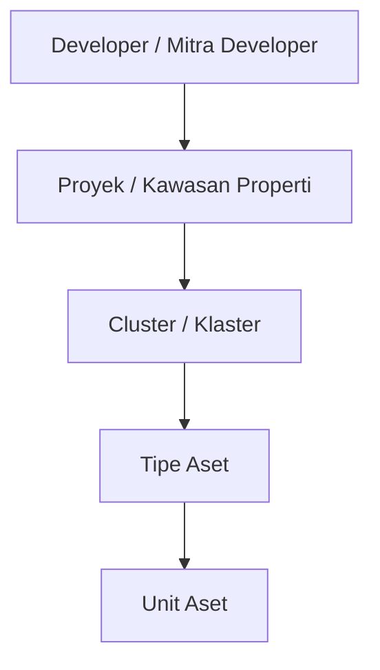

# 📝 Catatan Workshop - Penjelasan Alur Bisnis BSN (BA)

* **Tanggal**: 2026-11-02
* **Narasumber**: Business Analyst (BA)
* **Dokumenter**: Dani (QA)
* **Status**: In Progress (Updating berkala sesuai sesi workshop)

---

## 🏗️ 1. Hirarki Entitas Developer & Aset

Sebelum Aset Baru dapat dibuat, entitas Developer wajib terdaftar terlebih dahulu di sistem.

* **Urutan Hirarki**:
  1. **Developer**: Entitas badan usaha / mitra pengembang (memiliki Nomor Induk Berusaha, NPWP, CIF Developer, PIC, KC Pengampu, Legalitas & PKS).
  2. **Proyek**: Proyek kawasan properti yang dikembangkan oleh developer.
  3. **Cluster**: Klaster spesifik di dalam suatu proyek.
  4. **Tipe**: Tipe unit properti di dalam klaster.
  5. **Unit**: Unit fisik properti individual yang siap dipasarkan.

---

## 👥 2. Pembuatan & Approval Developer (Internal vs External)

Terdapat 2 jalur pendaftaran Mitra Developer:

| Jalur Pendaftaran | Kebutuhan Approval | Keterangan Flow |
| :--- | :---: | :--- |
| **Internal** (Backoffice / Admin) | ❌ **Tanpa Approval** | Langsung tercatat dan aktif di sistem tanpa proses persetujuan berjenjang. |
| **External** (Portal Developer) | ⚠️ **Wajib Approval** | Membutuhkan proses verifikasi dan persetujuan (approval) oleh pihak internal bank terlebih dahulu sebelum aktif. |

---

## 🏡 3. Alur & Aturan Aset Baru

### A. Role Kewenangan Aset Baru
* **Approval & Publishing**: Dilakukan oleh **Admin Pusat**.
* Admin Pusat berwenang menyetujui (*approve*) pendaftaran aset baru dan merilis (*published*) aset ke katalog agar live/dapat diakses publik.

### B. Urutan Tipe Aset Baru (Prioritas)
1. **Rumah**
2. **Appart** (Apartemen)
3. **Ruko**
4. *Tipe aset lainnya bebas (opsional/fleksibel)*

---

## 🖥️ 4. Snapshot Tampilan & Modul Terkait (Berdasarkan Sistem)

### Menu Navigasi Terkait (Stock Management):
* **Menu Stock Management**:
  * `Aset Baru`
  * `Approval Aset Baru` (Khusus Admin Pusat untuk verifikasi & publish)
  * `Katalog Marketing`
  * `Sold out Aset`
  * `Favourite Aset Baru`
* **Menu Developer**:
  * `Developer` → `List Developer` → `Detail Mitra Developer`
  * Tampilan Portofolio: Tab `Per Properti`, `Per Klaster`, `Per Unit` + Tombol aksi `+ Tambah Proyek / Aset Baru`
  * Legalitas: Berkas Legalitas & Dokumen PKS Developer, Verifikasi CIF Developer.

---

## 💡 5. QA Testing Notes & Checklist

* [ ] Verifikasi pembuatan developer via **Internal** langsung aktif tanpa trigger workflow approval.
* [ ] Verifikasi pendaftaran developer via **External** memicu status pending approval dan muncul di antrean approval.
* [ ] Validasi hirarki pembuatan: pastikan tidak bisa buat Proyek tanpa Developer, tidak bisa buat Unit tanpa Cluster & Tipe.
* [ ] Uji skenario hak akses role: pastikan tombol approve/publish aset baru hanya bisa dieksekusi oleh role **Admin Pusat**.
* [ ] Uji urutan pilihan dropdown Tipe Aset Baru (Rumah, Apartemen, Ruko di urutan teratas).
